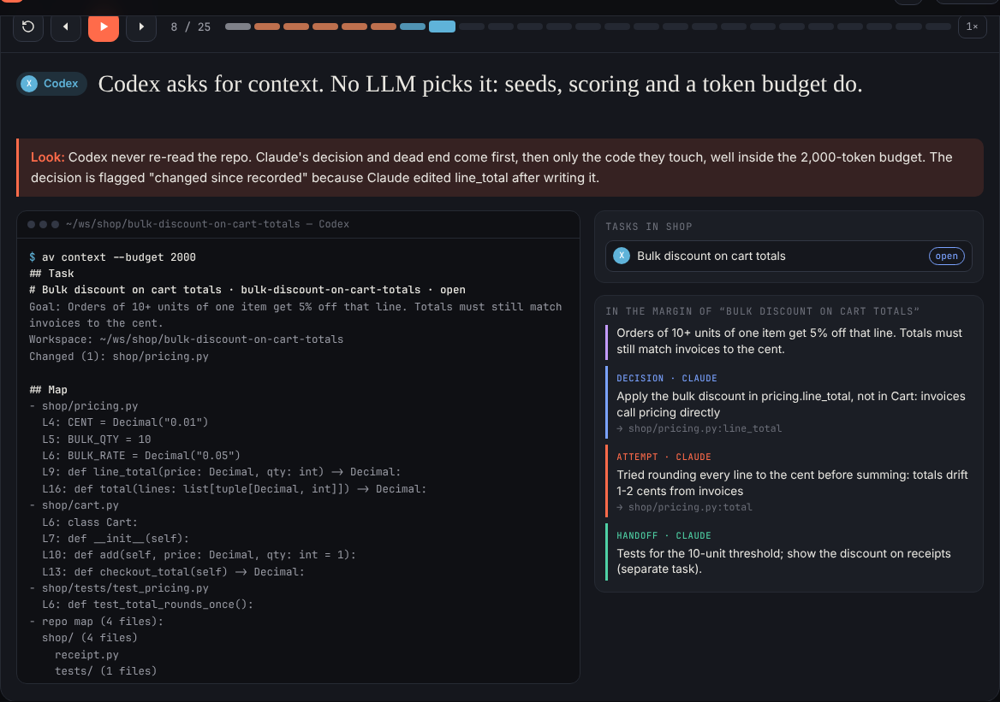

# Margincode

**Your next Claude Code session starts knowing last session's dead ends.** Margincode pins one-line notes (decisions, and what didn't work) to the code they
are about, and hands the next session a small brief built from them. One agent, one repo, no
second subscription needed. On a small Python repo that meant 12.9 % fewer turns at the same cost
in our October benchmark ([benchmark](bench/results/2026-10-27-haiku/)); a tracker run in November
found release 0.0.2 costing more ([Does it help?](#does-it-help)).

Use more than one agent and the same memory crosses vendors: Claude Code starts a job, Codex
picks it up from the brief, Gemini reviews it, and the reviewer merges.

*σχόλιον (margincode): a note written in the margin of a manuscript. Margincode keeps notes in the
margins of your code, so your AI agents stop forgetting.*

[](https://github.com/margincode-dev/open-margincode/stargazers)
[](LICENSE)
[](https://github.com/margincode-dev/open-margincode/releases)

**New in 0.0.5:** two security fixes. A daemon without `AV_TOKEN` refuses requests a web page on
another site could send (a `Host` that is an unknown dotted name, a foreign `Origin`); a client
that reaches it by such a name needs `AV_TOKEN` or `AV_ALLOWED_HOSTS`. A backup remote's
credentials stay out of logs, stored errors and answers. **In 0.0.4**, the first release from
this repository: agents can correct a stored record (`av record --supersedes`), packs say when a
record comes from reverted, abandoned or open work, `av dream` and `av verdict` give records a
second look, and `av init --for antigravity` connects Google's Antigravity CLI
([changelog](CHANGELOG.md)).

## A short story

**Monday.** Claude Code spends an hour on a flaky network call. First it tries the obvious fix,
a retry library, and finds out the library isn't installed in production. Then it finds the real
fix, gets halfway, and runs out of context.

**Tuesday.** Codex picks the job up. Git shows it a diff and nothing else. So it reads the whole
repo again, reaches for the same retry library, hits the same wall, and burns the same hour.

**Tuesday, with Margincode.** Codex opens the task and gets a one-page brief: the goal, what's done,
*"tried the retry library: not installed in prod, don't"*, and the three files that matter. It
starts where Claude stopped. Gemini reviews the work, and the reviewer merges it.

Git remembers **what** changed. Margincode also remembers **why**, and **what didn't work**, and
hands it to whichever agent comes next.

[](https://open.margincode.dev/demo)

**[Watch the recorded run](https://open.margincode.dev/demo)**

## Why it exists

Many developers now pay for more than one agent subscription, such as Claude Code, Codex, Gemini, Grok, Cursor or Antigravity, because each model is better at something different. Today those agents cannot share what they learned about your code, so every handoff between them is a diff with no reasoning, and each one starts from zero and repeats the dead ends of the others. Margincode gives all your subscriptions one repository, one backlog and one shared memory, so the next agent, from any vendor, starts where the last one stopped.

## What you get

- **Notes in the margin.** Agents leave one-line notes (decisions, dead ends) pinned to the code
  they touched. When any agent opens that file later, the note comes with it.
- **A brief instead of a re-read.** Every agent starts from a small brief, sized to a token
  budget: the goal, the history that matters, and the code to look at.
- **One backlog for all your agents.** Claude Code, Codex, Gemini, Cursor, Grok, Antigravity and OpenCode share it. Each
  takes the work it's best at, another agent reviews it, and the reviewer merges.
- **A dashboard** at `http://localhost:7420/ui` to watch them work.
- **A disk that stays lean.** Workspaces of merged and abandoned tasks are removed after an hour
  with their build output, a Rust repo's tasks build lean (a fifth of the disk of a default
  `cargo test`, each task in its own target dir), and the hooks tell an agent what it left outside
  its workspace. `av disk` shows where the space went; `av gc` reclaims it.

It runs on your machine. No Docker and no account, and it never sees your model keys.

## Does it help?

Measured so far, including where it didn't help:

- On a small Python repo, Claude Code needed **12.9 % fewer turns per task at the same cost**
  (October 2026, [benchmark](bench/results/2026-10-27-haiku/)).
- On the openevaluations tracker's run of 2026-11-20, on the same four tasks and model, release
  0.0.2 cost more than plain Claude Code: $0.0679 against $0.0540 for a leg of 12 sessions, too
  few for a claim. In that run every session was stopped once after its final answer and asked to
  record what it had changed, and its first record was refused for length. Both are changed in
  release 0.0.4
  ([report](https://github.com/vinhqbui/openevaluations/blob/main/docs/results/2026-11-20-tracker-haiku.md)).
  On the run of 2026-11-21, release 0.0.4 cost $0.0580 against $0.0545 for plain Claude Code on
  the same day, again a leg of 12 sessions and too few for a claim: 7 % more when paired by task
  (95 % interval 1 % to 14 %), with 20 % more billed tokens and 10 % fewer turns, and no session
  was stopped. The two runs differ in day and in Claude Code version
  ([report](https://github.com/vinhqbui/openevaluations/blob/main/docs/results/2026-11-21-tracker-haiku-margincode-0.0.4.md)).
- When one agent's lessons were passed on to the next, cost per solved task dropped by about
  **42 %**, and 30 of 30 tasks were solved instead of 18. Margincode did as well as a hand-written
  `NOTES.md`, without anyone having to write it.
- With 500 unrelated notes next to the ten that matter, cost per accepted task on DeepSeek Flash
  was **$0.0143 with Margincode against $0.0237 with a flat `NOTES.md`, 39.9 % less**. Without
  the extra notes the two cost the same ($0.0125 and $0.0126). Both solved 30 of 30 tasks, so
  this shows cost, not solve rate ([results](bench/results/2026-11-e4-scale/)).
- Not measured yet: large repositories.

## Try it

**The easy way: ask Claude.** Add the Margincode plugin to Claude Code once:

```bash
claude plugin marketplace add margincode-dev/open-margincode
claude plugin install margincode@margincode
```

Then open Claude Code in your repository and say *"set up Margincode for this repo"* (or run
`/margincode:setup`). Claude installs it, connects your agents and checks that everything works.
`/margincode:team` sets up several agents to share one backlog, and `/margincode:doctor` fixes a setup
that isn't working.

**By hand** (Linux, macOS on Apple silicon, or Windows through WSL):

```bash
curl -fsSL https://raw.githubusercontent.com/margincode-dev/open-margincode/main/scripts/install.sh | sh
cd your-repo && av init                       # starts Margincode, adds this repo, connects Claude Code
av init --for codex --for gemini --for cursor # the same for other agents (also grok, antigravity, opencode)
```

Restart your agent, then ask it to *"start an av task to …"*. Open `http://localhost:7420/ui` to
watch. A merge moves Margincode's own `main`, not your checkout's: `av repo backup NAME --remote URL`
pushes it to a git remote after every merge (a bare repo or GitHub; add `--branch av-main` to get
a branch you can open a pull request from), and `av log --repo NAME` shows it.

**Let the agent lead a team.** In our own use, one Claude Code or Grok session pointed at one av
task at a time, carried by the hooks, does the task but loses the thread between tasks. What
works better is to ask the session to run the backlog as a lead: *"take the av backlog: start a
subagent per task, monitor them, review what comes back and keep going"*. The session and its
subagents count as one agent to Margincode (the same name on every call), so it never reviews its
own work; another agent does. Size backlog items as whole jobs with a definition of done, not
single steps. We have not benchmarked this; it is what the project itself is built with.

Other channels ([details](docs/install.md)):

```bash
cargo binstall --git https://github.com/margincode-dev/open-margincode margincode-cli   # prebuilt, no compile
brew tap margincode-dev/open-margincode https://github.com/margincode-dev/open-margincode && brew install margincode
docker run -d -p 127.0.0.1:7420:7420 -e AV_LISTEN_OPEN=1 -v margincode:/data ghcr.io/margincode-dev/open-margincode
```

## ⭐ If it helps, star it

Margincode is a small open-source project. If it saved your agents a re-read, a
[star](https://github.com/margincode-dev/open-margincode/stargazers) is how other people find it.
Bugs and ideas are welcome in [issues](https://github.com/margincode-dev/open-margincode/issues).

## Learn more

- **[Reference](docs/reference.md)**: every command, configuration, the Docker stack, design,
  architecture and the full measurements.
- [Changelog](CHANGELOG.md) · [Contributing](CONTRIBUTING.md) · [Benchmarks](bench/README.md)
- The CLI is `margincode`, with the short alias `av`.

**How it was built.** Margincode is vibe-coded: AI coding agents (mostly Claude Code) wrote almost all
of the code, tests and docs, with one human steering and reviewing. Treat it as an experiment, not
as audited infrastructure. Some of the design borrows ideas from Anthropic's public article
[Redesigning source control](https://www.anthropic.com/research/redesigning-source-control).
Margincode is an independent project, **not affiliated with or endorsed by Anthropic**.

**Editions.** This repository is the free Community edition ([MIT](LICENSE)). It works with any
number of agents, with no seat limit. A hosted Commercial edition, **Margincode Cloud**, is planned but not available yet.
